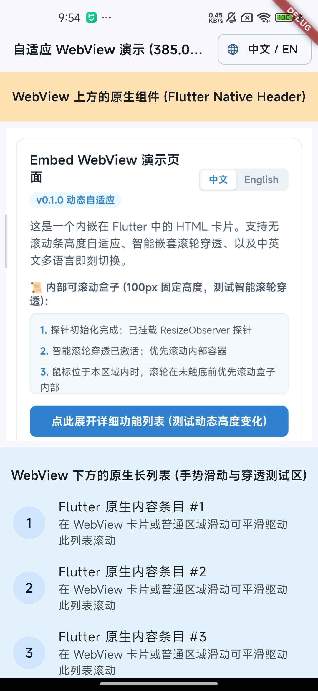
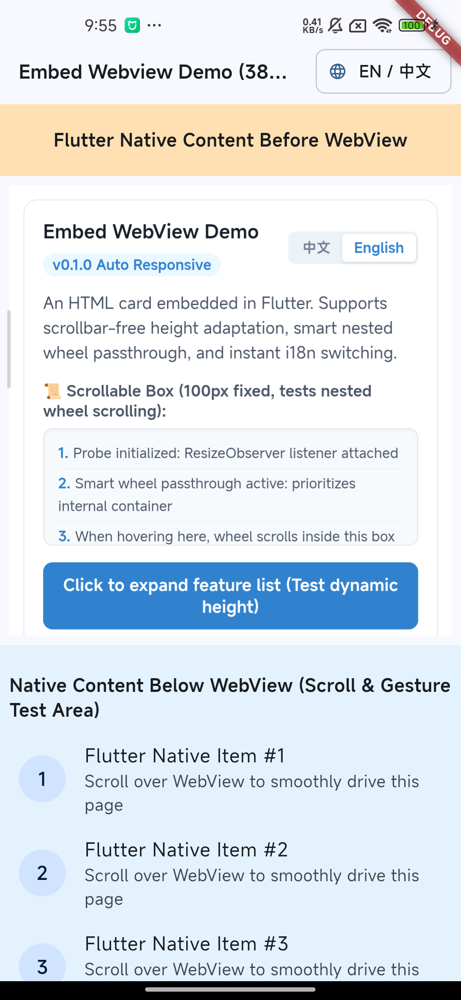

# embed_webview

[English](README.md) | [中文说明](README_CN.md)

[](https://pub.dev/packages/embed_webview)


A responsive, auto-height WebView widget for Flutter that dynamically sizes itself to fit its content using modern web ResizeObserver.

Eliminates blank space, cut-off content, and nested scrolling conflicts when embedding web content in Column, ListView, or SingleChildScrollView.

---

## Features

* **Dynamic Auto-Height**: Continuously monitors layout changes using modern Web `ResizeObserver` (handles async images, web fonts, and dynamic DOM expansion).
* **Dual Modes**: 
  * `EmbedWebView(html)` for raw HTML and rich-text snippets.
  * `EmbedWebView.network(url)` for remote web pages.
* **Smart Gesture & Scroll Routing (`scrollController`)**:
  * **Native Fling / Inertia Scroll**: Seamlessly triggers Flutter's native `goBallistic` simulation on touch release, giving outer page true physical deceleration and bounce.
  * **Absolute Screen Coordinate Damping**: Employs physical `screenY` tracking with `applyUserOffset` to eliminate viewport displacement jitter.
  * **Inner Scroll Protection**: Preserves independent scrolling for nested scroll containers (e.g. `<div style="overflow-y: scroll">`).
  * **Desktop Wheel Passthrough**: Passes mouse wheels smoothly to outer lists via native `pointerScroll` on macOS and Windows.
* **Hyperlink Interception (`onLinkTap`)**: Intercepts link clicks to prevent navigation inside the embedded card, allowing you to open them in external browsers.
* **Smooth Animation**: Built-in `AnimatedSize` transitions height changes smoothly without visual jumps.
* **Controller Access (`onWebViewCreated`)**: Provides access to `WebViewController` for direct JavaScript execution.
* **Multi-Platform Support**: Android, iOS, macOS, Windows, and Web.
* **Non-Intrusive**: Does not override your font sizes, colors, or layout, fully respecting your HTML and CSS.

---

## Supported Platforms

* **Android** (via `webview_flutter_android`)
* **iOS** (via `webview_flutter_wkwebview`)
* **macOS** (via `webview_flutter_wkwebview`)
* **Web** (via `webview_flutter_web` & standard HTML5 postMessage)
* **Windows** (via `webview_flutter_windows` or compatible engine)

---

## Getting Started

Add `embed_webview` to your `pubspec.yaml`:

```yaml
dependencies:
  flutter:
    sdk: flutter
  embed_webview: ^0.2.0
```

---

## Usage

### 1. Embedded HTML String

```dart
import 'package:embed_webview/embed_webview.dart';

EmbedWebView(
  '<p>Hello Flutter! <a href="https://flutter.dev">Visit Website</a></p>',
  initialHeight: 80.0,
  animate: true,
  onHeightChanged: (height) {
    debugPrint("Current height: $height");
  },
  onLinkTap: (url) {
    debugPrint("Clicked link: $url");
  },
)
```

### 2. Embedded in Scrollable List with Smooth Routing

Simply pass `scrollController` to enable zero-config native gesture coordination and mouse wheel passthrough:

```dart
final ScrollController _scrollController = ScrollController();

SingleChildScrollView(
  controller: _scrollController,
  child: Column(
    children: [
      Text('Header content before webview'),
      EmbedWebView(
        htmlContent,
        scrollController: _scrollController, // Auto-coordinates gestures & flings
        onLinkTap: (url) => launchUrl(Uri.parse(url)),
      ),
      Text('Long list content below webview'),
    ],
  ),
)
```

### 3. Remote Web Page

```dart
EmbedWebView.network(
  'https://flutter.dev',
  onLinkTap: (url) => debugPrint("Clicked link: $url"),
)
```

Save and run the project:

| Chinese Mode | English Mode |
| :---: | :---: |
|  |  |

---

## Parameters

| Parameter | Type | Default | Description |
| :--- | :--- | :--- | :--- |
| `webViewContent` | `String?` | - | Raw HTML string (default constructor only) |
| `url` | `String?` | - | Remote URL (named constructor `EmbedWebView.network` only) |
| `scrollController` | `ScrollController?` | `null` | Outer scroll controller; enables smooth wheel passthrough, gesture damping, and native fling simulation |
| `width` | `double?` | `null` | Widget width; defaults to maximum available parent width |
| `height` | `double?` | `null` | Fixed height; if `null`, height auto-adapts to content |
| `initialHeight` | `double` | `80.0` | Initial estimated height to eliminate visual jump before first render |
| `animate` | `bool` | `true` | Whether to animate height changes smoothly |
| `animationDuration` | `Duration` | `200ms` | Duration for height resize transition |
| `animationCurve` | `Curve` | `easeInOut` | Animation curve for height transition |
| `onHeightChanged` | `ValueChanged<double>?` | `null` | Callback when content height changes |
| `onLinkTap` | `ValueChanged<String>?` | `null` | Callback when a hyperlink is tapped (prevents internal navigation) |
| `onWebViewCreated` | `ValueChanged<WebViewController>?` | `null` | Callback providing the created `WebViewController` for direct JS execution |
| `onLanguageChanged` | `ValueChanged<String>?` | `null` | Callback when embedded web content notifies language changes |
| `gestureRecognizers` | `Set<Factory>?` | `null` | Custom gesture recognizers; automatically defaults to `EagerGestureRecognizer` when `scrollController != null` |
| `backgroundColor` | `String?` | `null` | Custom background color (e.g., `'#ffffff'`) |

---

## License

Apache-2.0 License. See [LICENSE](LICENSE) for details.
