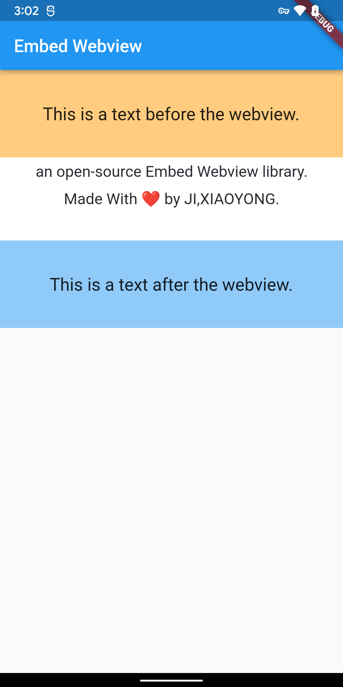

# embed_webview

[English](README.md) | [中文说明](README_CN.md)

[](https://pub.dev/packages/embed_webview)




`embed_webview` 是一个可直接嵌入 Flutter 页面内部、能够根据网页内容高度**自动自适应调整尺寸（Auto Height / Wrap Content）**的通用 WebView 组件。

内部通过现代 Web 标准的 ResizeObserver 实时感知内容尺寸变动，彻底解决异步网络图片加载、字体渲染完成、动态 DOM 展开等场景下的内容截断与内外多重滚动条冲突问题。

---

## 核心特性

* **动态高度自适应**：通过 ResizeObserver 实时监听内容高（自适应网络图片加载、Web 字体渲染及 DOM 动态展开）。
* **双模式支持**：
  * `EmbedWebView(html)`：本地 HTML/富文本片段渲染。
  * `EmbedWebView.network(url)`：直接嵌入远程网页并动态注入探针自适应。
* **超链接智能拦截 (`onLinkTap`)**：点击链接触发回调并在外部处理，防止在小卡片内迷失跳转。
* **平滑过渡动画**：内置 AnimatedSize，高度展开或收起时平滑过渡，无视觉跳动。
* **macOS 桌面支持**：支持 macOS 原生 WKWebView，可在 Mac 桌面端秒级启动与热重载调试。
* **无侵入设计**：不暴力篡改网页的字体大小、颜色与排版，充分尊重原网页 CSS。

---

## 支持平台

* **Android**（基于官方 `webview_flutter_android`）
* **iOS**（基于官方 `webview_flutter_wkwebview`）
* **macOS**（基于官方 `webview_flutter_wkwebview`）
* **Web**（基于官方 `webview_flutter_web`）

---

## 快速上手

在 `pubspec.yaml` 中添加依赖：

```yaml
dependencies:
  flutter:
    sdk: flutter
  embed_webview: ^0.1.0
```

---

## 使用示例

### 1. HTML 富文本自适应嵌入

```dart
import 'package:embed_webview/embed_webview.dart';

EmbedWebView(
  '<p>你好 Flutter！<a href="https://flutter.dev">打开官网</a></p>',
  initialHeight: 80.0,
  animate: true,
  onHeightChanged: (height) {
    debugPrint("当前自适应高度: $height");
  },
  onLinkTap: (url) {
    debugPrint("点击了超链接: $url");
  },
)
```

### 2. 远程网页 URL 嵌入

```dart
EmbedWebView.network(
  'https://flutter.dev',
  onLinkTap: (url) => debugPrint("点击超链接: $url"),
)
```

---

## 参数说明

| 参数 | 类型 | 默认值 | 说明 |
| :--- | :--- | :--- | :--- |
| `webViewContent` | `String?` | - | HTML 字符串内容（仅限默认构造函数） |
| `url` | `String?` | - | 远程网页 URL（仅限 `EmbedWebView.network` 构造函数） |
| `width` | `double?` | `null` | 指定宽度，为 `null` 时自适应父容器最大可用宽度 |
| `height` | `double?` | `null` | 固定高度，为 `null` 时由内部探针动态自适应撑开 |
| `initialHeight` | `double` | `80.0` | 初始预估高度，消除首帧加载时的视觉跳动 |
| `animate` | `bool` | `true` | 是否启用高度自适应平滑动画 |
| `animationDuration` | `Duration` | `200ms` | 动画过渡时长 |
| `animationCurve` | `Curve` | `easeInOut` | 动画过渡插值曲线 |
| `onHeightChanged` | `ValueChanged<double>?` | `null` | 真实高度发生变化时的通知回调 |
| `onLinkTap` | `ValueChanged<String>?` | `null` | 超链接点击回调（默认拦截小卡片内跳转） |
| `gestureRecognizers` | `Set<Factory>?` | `null` | 自定义手势竞技识别器，协调外层滚动视图的手势竞争 |
| `backgroundColor` | `String?` | `null` | 自定义背景色（如 `'#ffffff'`） |

---

## 许可证

Apache-2.0 许可证。详情请参阅 [LICENSE](LICENSE)。
